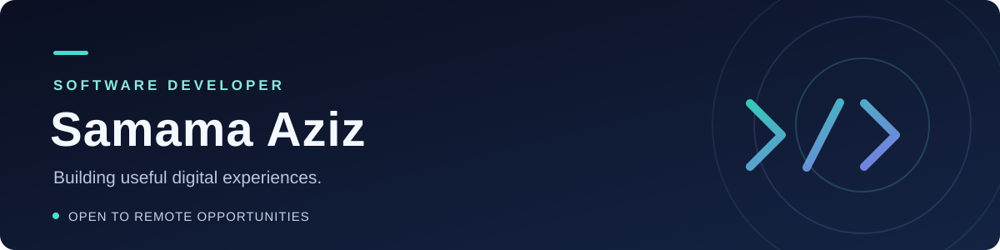

## Hello, I’m Samama 👋

I’m a software engineer with 3+ years of freelance experience building full-stack web, mobile, and financial technology solutions. I work across frontend and backend development, from responsive interfaces and REST APIs to databases, cloud services, and AI-powered workflows.

**Open to remote software engineering opportunities and collaboration.**

## 🛠️ My tech stack

**Also worked with:** SQL Server, MongoDB, Azure, Next.js, React Native, Node.js, Docker, REST APIs, microservices, Clean Architecture, and CQRS.

## 💼 Experience

**Freelance Software Engineer** · Self-employed · September 2022–present  
Building web and mobile applications, designing APIs, modernizing .NET code, and integrating cloud services and AI-powered workflows. I collaborate with clients and designers to turn requirements into practical software.

**Flutter Mobile Applications Development Intern** · Sovanza · July–September 2024  
Integrated REST APIs into Flutter applications and supported backend development, testing, and troubleshooting.

## 🚀 Selected projects

- **Unit Test Master** — Final-year project evaluating LLM-generated Java unit tests using SPF, JQF, and JaCoCo.
- **RAG-based Clinical Diagnostic System** — A retrieval-augmented system for analyzing clinical notes, with a Python data pipeline and Streamlit interface.
- **DuSpeak** — A cross-platform language-learning app built with Flutter, Firebase, Stripe subscriptions, and an AI chatbot.

## 🎓 Education

**BS in Computer Science** · FAST National University of Computer and Emerging Sciences · 2025

## 🤝 Let’s connect

I enjoy collaborating on useful products and learning from other developers. Feel free to connect with me here on GitHub.
